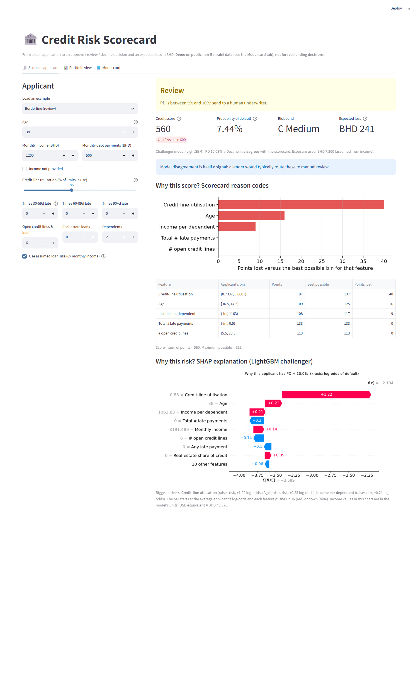
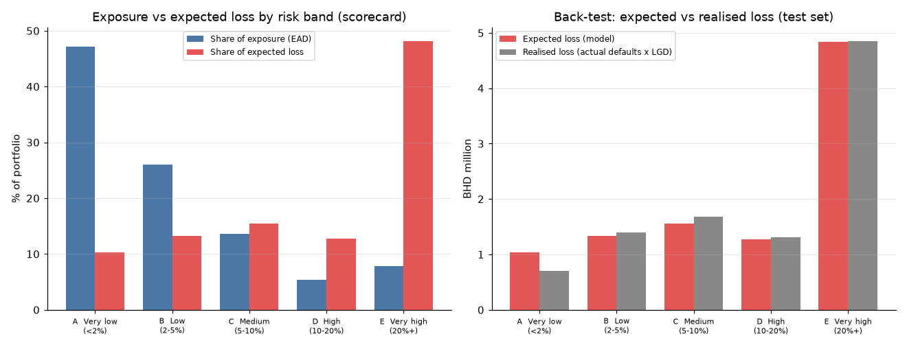
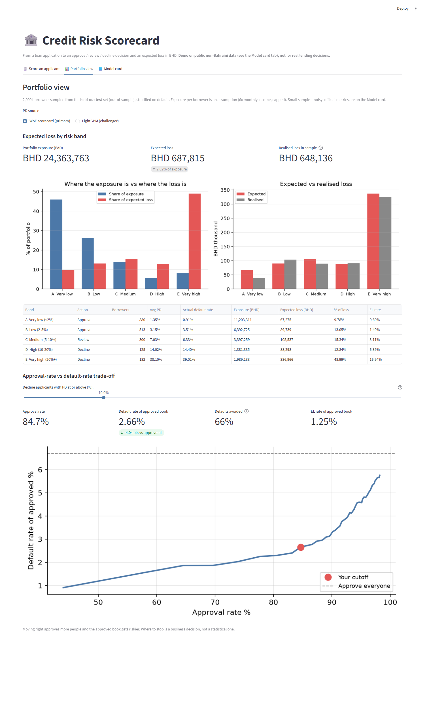
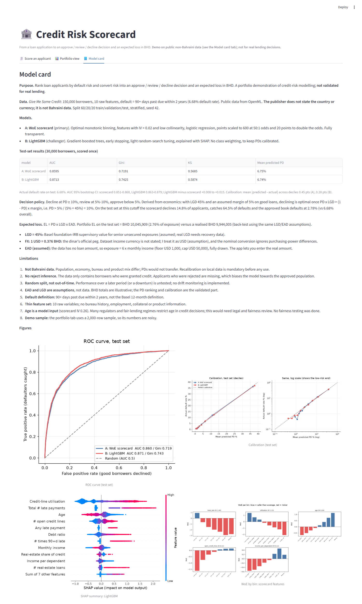

# Credit Risk Scorecard (BHD)

> **🔗 Live demo:** _link goes here once deployed (see [Deploy](#deploy-to-streamlit-community-cloud))_

Built a credit default model on **150,000 real borrowers**. It combines a traditional **WoE scorecard** with a **gradient-boosted model**,
explains every decision with **SHAP**, and turns predicted default risk into **expected loss in BHD** in a live Streamlit app.

| | |
|---|---|
| **Test-set Gini** | **0.719** scorecard, **0.743** LightGBM (AUC 0.860 / 0.871) |
| **KS** | 0.569 scorecard, 0.587 LightGBM |
| **Calibration** | mean predicted PD 6.75% vs actual 6.68% |
| **Expected loss back-test** | BHD 10.05M expected vs BHD 9.94M realised (+1.0%) |
| **Tests** | 56 automated tests (metrics, features, scorecard maths, expected loss, SHAP, end-to-end app) |

<p align="center"></p>

## The business problem

A Bahrain lender has to decide, for every loan application: **approve, send to a human, or decline?** Approving someone who defaults loses most of the loan;
declining someone who would have repaid loses the profit on it. This project answers three questions a credit-risk team cares about:

1. **How risky is this applicant?** A probability of default (PD) and a credit score.
2. **What should we do?** An approve / review / decline decision, with a cutoff derived from the economics rather than picked by feel.
3. **How much do we expect to lose?** Expected loss (EL = PD x LGD x EAD) in BHD, for one applicant and for a whole portfolio.

It must also be **explainable**: regulators and customers need reasons, not just a number.

## Data

[*Give Me Some Credit*](https://www.openml.org/d/46929): 150,000 borrowers, 10 raw features (utilisation, age, past-due history, income, debt ratio, credit lines, dependents),
target = 90+ days past due within 2 years (**6.68% default rate**). Public data from OpenML, no login required.
Raw data is **not** committed (`data/` is git-ignored); `python -m src.download_data` fetches it. `data/sample.csv` is a 2,000-row stratified sample from the
held-out test split, used by the demo.

> The original plan used Kaggle's Home Credit dataset. That requires joining a competition, so I used an open dataset anyone can reproduce with one command.
> Trade-off: fewer features (10), and no loan-amount column (see Expected loss assumptions).

## Results

Held-out **test set** (30,000 borrowers, scored once, after every design choice was fixed on the validation set):

| Model | AUC (95% CI) | **Gini** | **KS** |
|---|---|---|---|
| **A: WoE scorecard** (5 features, points table) | 0.8595 (0.851 - 0.868) | **0.7191** | **0.5685** |
| **B: LightGBM** (18 features) | 0.8713 (0.863 - 0.879) | **0.7425** | **0.5874** |

- LightGBM beats the scorecard by +0.012 AUC, and it is a real difference (paired bootstrap 95% CI on the gap: +0.008 to +0.015). That is the price of the scorecard's transparency, and it is small.
- Both models are **well calibrated** (predicted PDs track actual default rates across all deciles, slightly conservative at the very low-risk end), which matters because expected loss multiplies PD by money.
- Train / validation / test AUC: scorecard 0.854 / 0.845 / 0.860, LightGBM 0.882 / 0.859 / 0.871. No sign of leakage; LightGBM overfits slightly more.

**At the 10% PD decline cutoff (test set):**

| | Scorecard | LightGBM |
|---|---|---|
| Applicants declined | 14.8% | 16.8% |
| Defaults caught | 64.5% | 68.9% |
| Default rate of the approved book | **2.78%** | **2.50%** |
| (approve everyone) | 6.68% | 6.68% |

**Expected loss (scorecard PDs, test set, exposure BHD 363.5M):** BHD 10.05M = **2.76% of exposure**, against BHD 9.94M realised.
Risk is concentrated: the riskiest band (PD 20%+) is **7.8% of exposure but 48% of expected loss**.

<p align="center"></p>

## Decisions: why I did it this way

**Why a WoE scorecard + logistic regression?** Regulators and model-risk teams want interpretability. Weight-of-Evidence binning turns each feature into a handful of monotone bins;
a logistic regression on those becomes a **points table** anyone can read, audit and explain to a customer ("you lost 40 points on utilisation"). WoE also handles outliers, non-linearity
and missing values (each gets its own bin). Scaling: 600 points = 50:1 good:bad odds, 20 points doubles the odds. Features need IV > 0.02, low collinearity (|corr| < 0.5), and a
negative logistic coefficient (WoE is good-oriented; a positive one signals collinearity, which the code removes automatically). Result: 5 features.

**Why also gradient boosting?** Accuracy. LightGBM captures interactions the scorecard cannot, and SHAP makes it explainable. Showing both quantifies the **accuracy cost of interpretability**
(+0.023 Gini) and gives a challenger model: when the two disagree on a decision, the app flags it (a standard model-risk practice).

**Why Gini and KS, not accuracy?** Only 6.7% of borrowers default, so "approve everyone" is **93.3% accurate and worthless**. Gini (= 2 x AUC - 1) and KS measure how well the model *ranks*
risk, independent of the class mix and the cutoff. Calibration is checked separately.

**Why no class weighting?** I tested four imbalance fixes. Weighting did not improve ranking (AUC 0.857 vs 0.859) but inflated the average predicted PD to **30.6%** against a true 6.7%,
which would overstate expected loss ~4.6x. Probabilities must be real for EL, so both models are trained unweighted.

**Why a 10% cutoff?** Declining a good borrower costs the lender its margin (assumed 5% of exposure); approving a defaulter costs LGD (45%). With calibrated PDs, decline when
PD x LGD > (1 - PD) x margin, i.e. **PD > 0.05 / (0.05 + 0.45) = 10%**. I checked this on the validation set before touching test: the empirical cost-minimising cutoff was 9-10%, and the theory also
matched under 3% and 8% margin assumptions. A **review** band at 5-10% covers the range where the decision flips under plausible margins; below 5% is approve.

**Why LGD = 45%?** The Basel foundation-IRB supervisory value for senior **unsecured** exposures, which fits unsecured consumer credit. A real lender would estimate LGD from its own recovery data.

**Expected loss assumptions (stated plainly):**
- **EAD is assumed.** The dataset has no loan amount, so exposure = 6 x monthly income (floor USD 1,000, cap USD 50,000), treated as a fully drawn term loan. The app lets you type a real amount.
- **FX:** 1 USD = 0.376 BHD, the dinar's official peg, so the conversion is exact. But the dataset does not state its currency; treating income as USD is itself an assumption,
  and a nominal conversion ignores purchasing power.
- The BHD totals are **illustrative**. The PD ranking and calibration are the validated part. The back-test reuses the same LGD/EAD, so it validates the PDs, not the LGD.
- **Unexpected loss** (indicative Basel IRB retail formula, 99.9%): about BHD 18.3M, 5.0% of exposure, roughly 1.8x the expected loss.

**Other choices:** features are row-wise with fixed constants (no fitted statistics, so no leakage and the app scores one applicant exactly like training rows); placeholder codes 96/98 in the
late-payment columns are flagged and neutralised (those borrowers default at 55%); `DebtRatio` is treated as missing when income is missing (it is a dollar amount there, not a ratio);
exact duplicate rows are kept (they are thin-file borrowers, not errors); the split is stratified 60/20/20; the test set is used once.

## Limitations

1. **Not Bahraini data.** Population, economy, bureau and product mix differ, so PDs would not transfer. Recalibration on local data is mandatory before any use.
2. **No reject inference.** The data only contains borrowers who were granted credit; rejected applicants are missing, which biases the model toward the approved population.
3. **Random split, not out-of-time.** Performance over a later period or a downturn is untested; no drift monitoring is implemented.
4. **EAD and LGD are assumptions**, and the FX conversion is nominal (the peg is exact, but the data's currency is assumed).
5. **Default definition** is 90+ days past due within 2 years, not the Basel 12-month definition.
6. **Thin feature set**: 10 raw variables; no bureau history, employment, collateral or product information.
7. **Age is a model input.** Many regulators restrict age in credit decisions; this would need legal and fairness review. No fairness testing was done.
8. A demo: no authentication, no audit log, not for real lending decisions.

## The app

Three tabs: **Score an applicant** (score, PD, band, decision, expected loss, scorecard reason codes, SHAP waterfall, challenger flag), **Portfolio view** (EL by band, approval-rate vs
default-rate slider), and a **Model card** whose numbers are read straight from `reports/`.

<p align="center">


</p>

## Repository

```
credit-risk-scorecard/
├── data/                  # git-ignored except sample.csv (2,000-row demo sample)
├── notebooks/01_eda.ipynb # EDA with 5 plain-English findings
├── src/
│   ├── download_data.py   # fetches the open dataset from OpenML
│   ├── features.py        # cleaning + feature engineering + stratified split
│   ├── woe.py             # WoE binning, IV, scorecard points (Model A)
│   ├── train.py           # trains both models, saves to models/
│   ├── evaluate.py        # AUC, Gini, KS, calibration, confusion matrix, decision policy, plots
│   ├── explain.py         # SHAP (global + waterfall), reused by the app
│   └── expected_loss.py   # PD x LGD x EAD in BHD, risk bands, indicative Basel UL
├── models/                # scorecard.json (auditable bin tables), lgbm.txt
├── app/streamlit_app.py
├── reports/               # metrics, scorecard table, IV table, figures/, screenshots/
├── tests/                 # 56 tests
├── requirements.txt       # runtime (what the deployed app installs)
└── requirements-dev.txt   # + training, notebook and test tools
```

## Run it locally (Windows)

```powershell
python -m venv .venv
.\.venv\Scripts\activate
pip install -r requirements-dev.txt

python -m src.download_data     # raw data -> data/raw_gmsc.csv (git-ignored)
python -m src.features          # features, split, sample.csv
python -m src.train             # Model A + Model B -> models/ (byte-for-byte reproducible)
python -m src.evaluate          # test-set metrics, plots
python -m src.expected_loss     # EL by band, trade-off
python -m src.explain           # SHAP plots
streamlit run app/streamlit_app.py
pytest                          # 56 tests
```

The whole pipeline is deterministic: retraining reproduces the saved model files byte-for-byte.

## Deploy to Streamlit Community Cloud

1. Push this repo to GitHub (public).
2. At [share.streamlit.io](https://share.streamlit.io) choose **Create app** -> *Deploy a public app from GitHub*.
3. Repository: this repo, branch `main`, main file path **`app/streamlit_app.py`**.
4. **Advanced settings -> Python version: 3.13** (the version this project was built and tested on).
5. Deploy, then paste the live URL at the top of this README.

The deployed app installs only `requirements.txt`; it needs no raw data and no training libraries (`optbinning` is only used when fitting).
